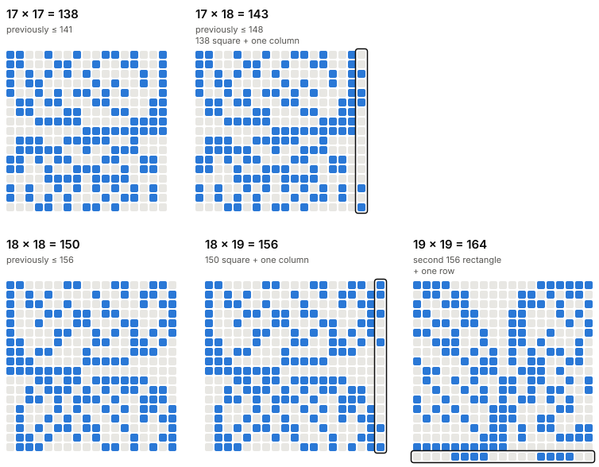
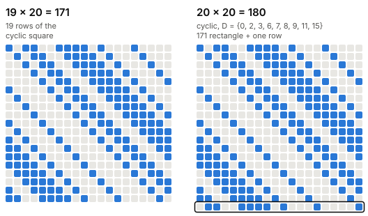
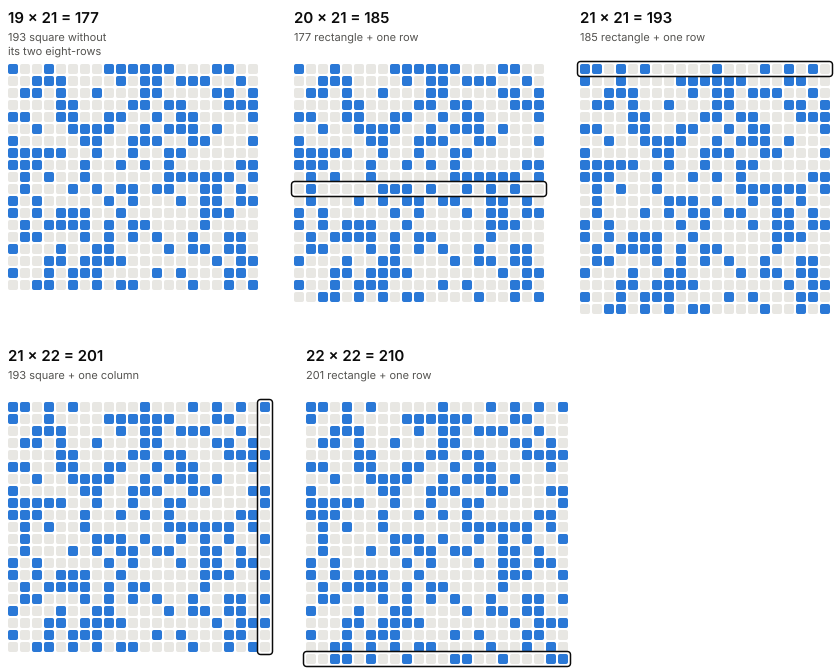
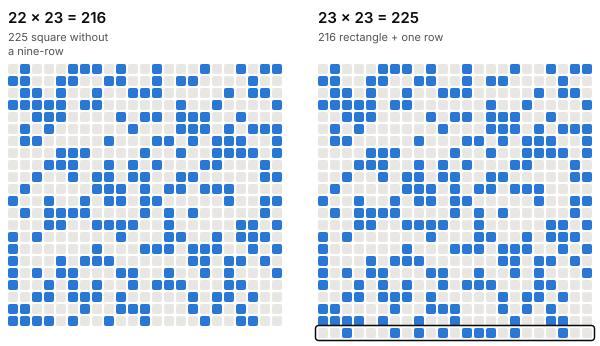

# Zarankiewicz numbers

This repository collects exact values of Zarankiewicz numbers. Each value comes with explicit extremal matrices and a proof that can be replayed by computer.

The Zarankiewicz number $z(m,n;s,t)$ is the largest number of ones in an $m \times n$ binary matrix that contains no all-ones $s \times t$ submatrix. The rows and columns of the submatrix may be any $s$ rows and any $t$ columns, not necessarily adjacent. Equivalently, it is the largest number of edges in a bipartite graph with parts of sizes $m$ and $n$ that has no $K_{s,t}$ subgraph. This repository uses this maximum-ones convention throughout.

The consolidated paper covers the seven consecutive square maxima from 17 × 17 through 23 × 23, the intervening rectangles, and bounds at order 24. [Paper (PDF)](paper/zarankiewicz-numbers.pdf) · [LaTeX source](paper/zarankiewicz-numbers.tex) · [Earlier summary through 22 × 22](results-through-22.md)

## Results

| Value | Directory | Contents |
|---|---|---|
| $z(16,17;3,3) = 132$ | [`z16x17-k33`](z16x17-k33) | Witness and exhaustion excluding 133, independent of [Wei’s earlier release](https://doi.org/10.5281/zenodo.24553293) |
| $z(16,18;3,3) = 137$ | [`z16x18-k33`](z16x18-k33) | Witness and exhaustion excluding 138, independent of [Wei’s earlier release](https://doi.org/10.5281/zenodo.24553293) |
| $z(17,17;3,3) = 138$ | [`z17-k33`](z17-k33) | Two inequivalent witnesses and exhaustion excluding 139 |
| $z(17,18;3,3) = 143$ | [`z17x18-k33`](z17x18-k33) | Witness and exhaustion excluding 144 |
| $z(18,18;3,3) = 150$ | [`z18-k33`](z18-k33) | Witness and exhaustion excluding 151 |
| $z(18,19;3,3) = 156$ | [`z18x19-k33`](z18x19-k33) | Two witnesses and exhaustion excluding 157 |
| $z(19,19;3,3) = 164$ | [`z19-k33`](z19-k33) | Witness and a row-deletion bound from the 18 × 19 value |
| $z(19,20;3,3) = 171$ | [`z19x20-k33`](z19x20-k33) | Cyclic witness and exhaustion excluding 172 |
| $z(19,21;3,3) = 177$ | [`z19x21-k33`](z19x21-k33) | Witness and exhaustion excluding 178 |
| $z(20,20;3,3) = 180$ | [`z20-k33`](z20-k33) | Cyclic witness and a row-deletion bound from the 19 × 20 value |
| $z(20,21;3,3) = 185$ | [`z20x21-k33`](z20x21-k33) | Witness and a reduction of 186 to the 19 × 21 value |
| $z(21,21;3,3) = 193$ | [`z21-k33`](z21-k33) | Witness and a reduction of 194 to the 19 × 21 value |
| $z(21,22;3,3) = 201$ | [`z21x22-k33`](z21x22-k33) | Witness and exhaustion excluding 202 |
| $z(22,22;3,3) = 210$ | [`z22-k33`](z22-k33) | Witness, a row-deletion bound from the 21 × 22 value and uniqueness of the extremal square |
| $z(22,23;3,3) = 216$ | [`z22x23-k33`](z22x23-k33) | Witness and exhaustion excluding 217 |
| $z(23,23;3,3) = 225$ | [`z23-k33`](z23-k33) | Witness and a row-deletion bound from the 22 × 23 value |

Before this work the best published upper bounds for 17 × 17, 17 × 18 and 18 × 18 were 141, 148 and 156 ([Collins et al., Table 4](https://www.cs.rit.edu/~spr/PUBL/crwr16.pdf)). The 17 × 18 proof uses the 17 × 17 value, the 18 × 18 proof uses the 17 × 18 value, and the 18 × 19 proof uses both of those. The 19 × 19 bound then follows from the 18 × 19 value by deleting rows. The 19 × 20 proof uses the 18 × 19 and 19 × 19 values. The 20 × 20 bound then follows from the 19 × 20 value by deleting rows. The 19 × 21 proof uses the 18 × 19 and 19 × 20 values together with new bounds of 163 on 18 × 20 and 170 on 18 × 21. The 20 × 21 and 21 × 21 proofs show that a heavier matrix would have one or two parallel lines of degree eight, whose deletion would leave 178 ones on 19 × 21. The 21 × 22 proof uses the 20 × 21 and 21 × 21 values, and the 22 × 22 bound follows from the 21 × 22 value by deleting rows. The 22 × 23 proof uses the 21 × 22 value, through the [upper bound of 208 on 21 × 23](z21x23-k33/no-209.md), which forces every row of a 217-one rectangle to have degree at least nine, and the uniqueness of the extremal 22 × 22 square. The 23 × 23 bound then follows from the 22 × 23 value by deleting rows. The 17 × 17 value also gives a short proof that the bipartite Ramsey number $b(2,2,3)$ is 17, first proved by [Rowshan and Gholami](https://arxiv.org/abs/2108.03572).

Three of the first five witnesses extend an earlier matrix by one line, outlined.



The 19 × 20 and 20 × 20 witnesses come from one cyclic square, in which each row shifts the previous one by a place.



The witnesses from 19 × 21 to 22 × 22 all come from one 193-one square. Deleting rows of eight ones gives the two smaller rectangles, and adding a column and then a row gives the two larger matrices.



The 22 × 23 and 23 × 23 witnesses come from a 225-one square built from eight orbits of cells under a group of row and column permutations.



## Bounds under investigation

| Size | Lower bound | Upper bound | Evidence |
|---|---:|---:|---|
| 18 × 20 | 162 | 163 | [Seven-column cases and remaining profiles](z18x20-k33/README.md) |
| 18 × 21 | 168 | 170 | [Upper bound](z20x21-k33/core-search.md) and deletion of the three smallest rows from the [193-one square](z21-k33/witness-193.txt) |
| 21 × 23 | 207 | 208 | [Exclusion of 209 by counting short rows](z21x23-k33/no-209.md) |

## OEIS

These results give new terms of the following sequences. Some sequences count the least number of ones that forces an all-ones submatrix, which is one more than the Zarankiewicz number, and some count the complementary problem for zero submatrices.

| Sequence | Name | New term | From |
|---|---|---|---|
| [A350304](https://oeis.org/A350304) | Maximum number of 1's in an n X n binary matrix without an all-ones 3 X 3 submatrix | a(17) = 138, a(18) = 150, a(19) = 164, a(20) = 180, a(21) = 193, a(22) = 210, a(23) = 225 | `z17-k33`, `z18-k33`, `z19-k33`, `z20-k33`, `z21-k33`, `z22-k33`, `z23-k33` |
| [A001198](https://oeis.org/A001198) | Zarankiewicz's problem k_3(n) | a(17) = 139, a(18) = 151, a(19) = 165, a(20) = 181, a(21) = 194, a(22) = 211, a(23) = 226 | `z17-k33`, `z18-k33`, `z19-k33`, `z20-k33`, `z21-k33`, `z22-k33`, `z23-k33` |
| [A350237](https://oeis.org/A350237) | Minimum number of 1's in an n X n binary matrix with no zero 3 X 3 submatrix | a(17) = 289 − 138 = 151, a(18) = 324 − 150 = 174, a(19) = 361 − 164 = 197, a(20) = 400 − 180 = 220, a(21) = 441 − 193 = 248, a(22) = 484 − 210 = 274, a(23) = 529 − 225 = 304 | `z17-k33`, `z18-k33`, `z19-k33`, `z20-k33`, `z21-k33`, `z22-k33`, `z23-k33` |
| [A347473](https://oeis.org/A347473) | Maximum number of nonzero entries allowed in an n X n matrix to ensure there is a 3 X 3 zero submatrix | a(17) = 151 − 1 = 150, a(18) = 174 − 1 = 173, a(19) = 197 − 1 = 196, a(20) = 220 − 1 = 219, a(21) = 248 − 1 = 247, a(22) = 274 − 1 = 273, a(23) = 304 − 1 = 303 | `z17-k33`, `z18-k33`, `z19-k33`, `z20-k33`, `z21-k33`, `z22-k33`, `z23-k33` |
| [A006621](https://oeis.org/A006621) | Zarankiewicz's problem k_3(n,n+1) | a(16) = 133, a(17) = 144, a(18) = 157, a(19) = 172, a(20) = 186, a(21) = 202, a(22) = 217 | `z16x17-k33` (first by Wei), `z17x18-k33`, `z18x19-k33`, `z19x20-k33`, `z20x21-k33`, `z21x22-k33`, `z22x23-k33` |

The listed terms of A006621 stop at a(12). The missing a(13) = 99, a(14) = 113 and a(15) = 124 follow from the exact values $z(13,14;3,3)=98$, $z(14,15;3,3)=112$ and $z(15,16;3,3)=123$ in [Collins et al., Table 4](https://www.cs.rit.edu/~spr/PUBL/crwr16.pdf).

## Layout

Each result has its own directory with a README describing the files and how to replay the verification. A directory typically contains:

- the witness matrices as plain text, one row per line;
- a written proof, in the README or in Markdown files, often with a typeset PDF;
- the verification sources and a `verify_exact.py` script that replays the whole check.

## Replaying the proofs

Use Python with assertions enabled (omit `-O` and `-OO` and leave `PYTHONOPTIMIZE` unset). The native searches require Python 3.10 or later, a C++20 compiler available as `c++`, and the 64-bit nauty headers and library. For the full proof through order 23, the degree-profile calculation also uses OR-Tools, SciPy and NumPy. From the repository root, the following installs the tested direct dependencies in a fresh Python 3.12 environment and runs that calculation.

```sh
python3.12 -m venv .venv
. .venv/bin/activate
python -m pip install -r requirements-replay.txt
python z22x23-k33/verify_three_profiles.py
```

The expected result is 298 certified exclusions out of 302 profile pairs, leaving four. The [three-column proof](z22x23-k33/three-profile-proof.md) describes the remaining checks. The historical [SAT replay](z21x23-k33/start4.md) separately uses python-sat and drat-trim. The optional [parent crop check](z21x23-k33/parent-extensions.md) uses NetworkX.

If nauty is not on the compiler's default search paths, as with Homebrew on Apple Silicon, pass them through `CXXFLAGS` and `LDFLAGS`:

```sh
CXXFLAGS=-I/opt/homebrew/include LDFLAGS=-L/opt/homebrew/lib python3 verify_exact.py
```

## License

The repository is licensed under [Apache-2.0](LICENSE). Cited papers are linked rather than redistributed.
