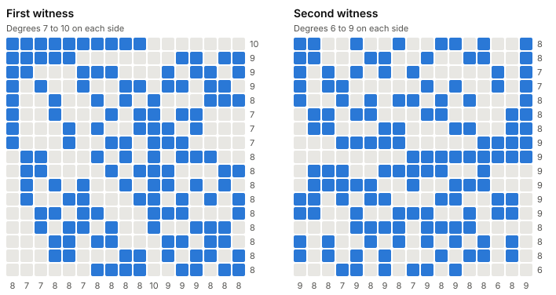

# The 17 × 17 Zarankiewicz number for K₃,₃

A 17 × 17 binary matrix can contain at most **138 ones** while avoiding an all-ones 3 × 3 submatrix. Any three rows and any three columns may be chosen.

The [proof](marked-nine.md) gives the counting argument and the exhaustive cases. The [first witness](witness-138.txt) and [second witness](witness-138-six.txt) attain the bound and have different row-degree profiles. The [PDF](z17-exact.pdf) prints both matrices. The verification sources are in this directory.



In the picture each filled square is a one, and the numbers on the right and below are the row and column degrees. Run `python3 render_witnesses.py` to redraw it from the witness files.

As a corollary, $74+74+138<289$ gives a short proof that the bipartite Ramsey number $b(2,2,3)$ is 17, first proved by [Rowshan and Gholami](https://arxiv.org/abs/2108.03572). The proof explains this and lists the external inputs from Collins et al.

In the OEIS this gives a(17) = 138 in [A350304](https://oeis.org/A350304), 139 in [A001198](https://oeis.org/A001198), 151 in [A350237](https://oeis.org/A350237) and 150 in [A347473](https://oeis.org/A347473).

## Replay

From this directory, run the following with Python 3.10 or newer, a C++20 compiler available as `c++`, and the nauty development headers and library installed.

```sh
python3 verify_exact.py
```

The verifier checks both witnesses, rebuilds the finite catalogues, and checks the upper bound. Its final line ends with `Exact value 138.`

If nauty is not on the compiler's default search paths, as with Homebrew on Apple Silicon, pass them through `CXXFLAGS` and `LDFLAGS`, for example `CXXFLAGS=-I/opt/homebrew/include LDFLAGS=-L/opt/homebrew/lib python3 verify_exact.py`. A complete replay takes about eight minutes; the proof records two runs with their tool versions.
